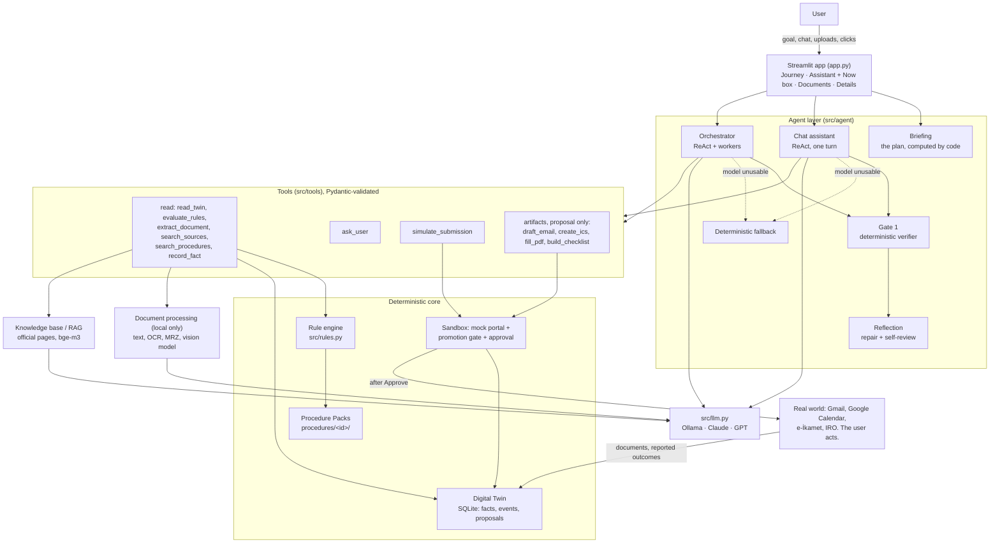
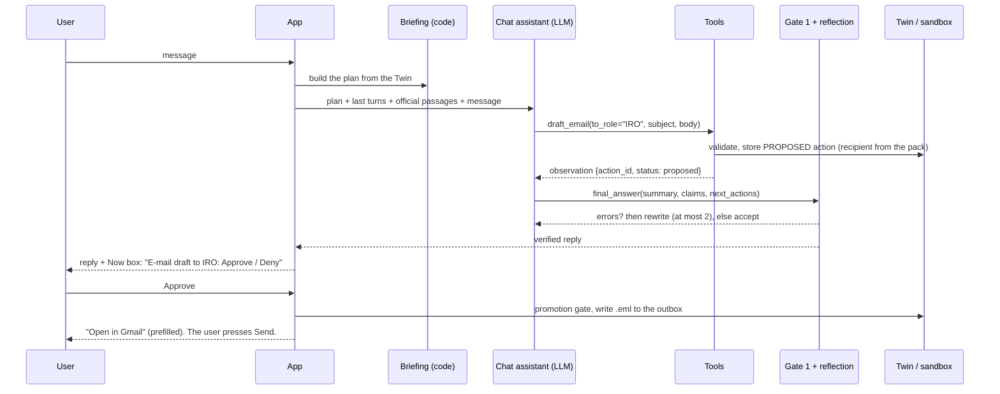

# Personal Bureaucracy Agent: the whole project in one document

CS58012 Agentic AI Systems, Sabancı University. Written 2026-11-25 on branch `feature/dani-version-two`.
This file explains **what** the agent is, **why** someone would use it, **how** it is built, and **what the user
should experience**. Each module has a one-page explanation in `docs/modules/`, and every design decision is
recorded in `docs/migration_plan.md`.

---

## 1. In one paragraph

The user states a goal in plain language, for example *"I want to apply for my first İkamet"*. The agent:
- finds the procedure;
- asks for the right documents and reads them;
- works out, requirement by requirement, where the user is, what is missing and what is wrong;
- guides them **one step at a time** until they can do the official step.

Along the way it prepares what the user needs: a checklist of the file, the filled form, calendar reminders for
deadlines, and an e-mail to the university office. An approved e-mail opens in **Gmail** and an approved reminder
in **Google Calendar**, already filled in. The user presses Send or Save; the agent never sends, books, pays or
submits anything itself.

The core principle is **the LLM proposes, the code verifies**. The language model understands the goal, chooses
the next step and the tool, and writes the words. Deterministic Python checks rules, dates and state and has the
last word. Unknown facts stay unknown and are never guessed.

---

## 2. The problem: why this agent is useful

An incoming exchange student who arrives in Türkiye has to get a short-term residence permit (İkamet) within
their legal stay. The procedure is hard for a newcomer:

| What makes it hard | What happens without help |
|---|---|
| The rules are spread over several official pages: Sabancı IRO, Migration Management, the e-İkamet portal. They change every year (fees, forms). | The student reads old blog posts or asks friends, and follows the wrong version. |
| Many small conditions depend on each other. Examples: passport validity beyond the permit, health insurance coverage dates, address proof, the photo, the fee, the entry date. | One forgotten detail means a refused file, a new appointment and lost weeks, sometimes past the legal stay. |
| The documents are in several languages and formats (passport MRZ, entry stamp, insurance policy, rental contract in Turkish). | The student does not know which value in which document matters. |
| The steps happen in a fixed order: online application → fingerprints / GI number → scans to IRO → physical submission. | The student does not know where they are or what comes next. |
| A generic chatbot answers confidently. | It invents fees, dates and requirements, which is dangerous in a legal procedure. |

**What the agent adds:**
1. **Clarity.** The agent always knows "where you are" (the journey) and gives one next action at a time.
2. **Correctness you can check.** Every requirement is evaluated by code from the pack's rules, which cite
   official sources. Answers are verified by code before the user sees them (Gate 1).
3. **Less work.** Values are read from the documents, and the form, checklist, reminders and e-mails are
   prepared for the user.
4. **Safety.** Nothing happens in the real world without the user's approval. What the agent is unsure about is
   shown to the user to confirm, never silently believed.
5. **Memory.** The Digital Twin remembers everything between sessions. The user comes back days later and
   continues where they left off.

**Who it is for:** first the incoming exchange students at Sabancı (first İkamet and its extension). The same
engine also runs the Turkish identity card procedures (first card and renewal). The architecture is generic: a
new procedure is a new folder of data, with no engine code.

### Why an agent and not a checklist or a chatbot
The evaluation compares three systems on the same 25 scenarios (§9):

| System | What it is | Weakness |
|---|---|---|
| A: static checklist | the requirements as a list | does not read your situation: correct verdict 81% of the time, a valid personalised answer 16% |
| B: single LLM | a chatbot without state, rules or tools | invents rules and dates, cannot check anything |
| **D: our agent** | orchestrator + ReAct workers + tools + Twin + Gate 1 | slower; needs a model (but falls back to a plan written by code) |

---

## 3. Principles and hard rules

| Principle | How the code enforces it |
|---|---|
| The LLM never decides whether a rule is met, and never computes a date | `evaluate_rules` (three-valued: pass / fail / unknown) is the only judge. Gate 1 refuses any claim that differs from it and any date that does not come from facts or rules. |
| Unknown stays unknown | A missing fact is `None`, so the rule is `unknown`, never `fail`. If two documents disagree, the value becomes unknown until the user chooses. |
| Only confirmed facts reach the rules | Values stated in the chat, and values read with low certainty, wait for the user's *Yes, that's right* or *Change it*. |
| Side effects are proposals | `draft_email`, `create_ics`, `fill_pdf` and `build_checklist` create a PROPOSED action. Only the user's *Approve* turns it into a file (and a Gmail / Calendar link). |
| Every rule cites an official source | `source_ids` must exist in `sources.json`. A rule nobody has checked yet is `unverified`, and any answer that uses it must say so. |
| Tool arguments are validated | Pydantic validates every call before the tool runs. An invalid call becomes an error observation for the model, never an execution. |
| The app never crashes because of the model | Schema-constrained output → one retry → deterministic fallback (the plan written by code). |
| Privacy | Documents are read only by local models. A cloud model, if enabled, receives the state computed by code, never the pages. API keys stay in the environment. Synthetic data only in the repository. |

---

## 4. Architecture

### 4.1 The big picture



### 4.2 The layers, from the bottom up

**1. Procedure Packs: a procedure is data** (`procedures/<id>/`, `src/pack.py`, `src/models.py`)
- `procedure.json` holds:
  - **fields**: what can be known, each with a plain question, whether to ask it now or later, and choices;
  - **documents**: what to upload and which fields each one gives, with optional ones marked;
  - **sections**: groups of rules, each handled by one worker;
  - **stages**: the official steps, with the rules each needs;
  - **forms** and **contacts**, for example IRO with its address from the official page.
- `rules.json` holds the rules as JSON condition trees, each with its source.
- `sources.json` and `sources_text/` hold the official pages as citable text.
- `eval/scenarios.json` holds the test cases with the expected verdicts.
- `python -m src.pack validate <id>` checks a pack. **Adding a procedure changes no engine code.**

| Pack | Rules | Status | Sections · documents · stages |
|---|---|---|---|
| `ikamet_first` (first residence permit, exchange students) | 30 | 29 verified (converted from milestone 1), R030 unverified until IRO confirms | 7 · 9 · 4 |
| `ikamet_extension` | 8 | unverified | 5 · 4 · 1 |
| `tc_kimlik_first` (Turkish ID card, first card) | 15 | unverified (they quote the NVİ pages) | 5 · 3 · 1 |
| `tc_kimlik_renewal` (expired, lost, damaged) | 14 | unverified | 5 · 2 · 1 |

**2. Rule engine** (`src/rules.py`)
- Evaluates every rule over the confirmed facts with three-valued logic: `pass`, `fail` or `unknown` (information
  missing).
- Computes dates (for example "passport valid 60 days beyond the permit") in Python.
- Is the only source of truth for verdicts. The mock portal and Gate 1 reuse it.

**3. Digital Twin** (`src/twin/`): the agent's environment
- A SQLite database per user and procedure. It holds documents, **facts** (each with provenance, source quote,
  page, confirmation, and validity dates), events, proposals, simulations, run logs, chat messages and episodes.
- **History is never overwritten**: a new value closes the old one. Conflicts make a value unknown until the user
  chooses. Derived values (months of stay, documents complete) are computed on read, so they never go stale.
- **Two-way flow**:
  - *real → twin*: documents, statements, confirmations, outcomes the user reports, rule updates;
  - *twin → real*: only approved artifacts.

**4. Document processing** (`src/document_processing/`, `src/tools/extract_document.py`), always local
- One upload may hold several documents. They are split where a title or a machine-readable zone starts, and every
  page is read.
- The type is recognised by title, MRZ, keywords, the model or the vision model.
- **MRZ** values (passport) are checked by their check digits.
- Scans and photos go through **OCR**. Pictures that nothing else can name (a border stamp) go to a small **vision
  model** (`qwen3-vl:2b-instruct`), and code compares its values with the OCR text.
- Every value needs a **quote that is really on the page**. Fields that span several lines, such as the full home
  address, are read whole.
- **Reflection on documents:** a value whose quote is not on the page is read a second time with the reason. What
  code still cannot check waits for the user's confirmation.

**5. The agent** (`src/agent/`): Orchestrator-Workers with ReAct, on LangGraph

```
START → decide → act → decide …            ReAct: the model picks a tool + arguments, code runs it, the model observes
              act → verify → END            Gate 1 passed
                    verify → decide         structured errors back to the model (repair)
                    verify → END            still wrong: flagged for human review
decide/act → fallback → END                 2 invalid steps in a row, a loop, or out of steps
```

- **Briefing (the plan, no model)** (`briefing.py`). It turns the Twin into one ordered plan:
  1. *decide*: approve what the agent prepared;
  2. *fix*: blocking requirements that fail;
  3. *confirm*: values to check, documents that disagree;
  4. *upload*: documents that answer open questions;
  5. *answer*: the remaining questions;
  6. *improve*: advisory requirements;
  7. *try*: the official step in the sandbox.

  **This is where the plan comes from.** The model explains it, but code computes it.
- **Chat assistant** (`chat.py`). The same graph without workers, at most 4 steps per turn. It starts from:
  - the plan;
  - the last 4 exchanges;
  - the official passages retrieved for the message.

  So most questions need one model call. It can record what the user says (unconfirmed), search the sources,
  prepare proposals, and try a stage in the sandbox.
- **Orchestrator + workers** (`orchestrator.py`, `worker.py`), the "Full check by the agent team":
  - the orchestrator (at most 8 steps) gives each section of the pack to a **worker** with `delegate_section`;
  - each worker is a small ReAct loop (at most 5 steps) with read-only tools (`read_twin`, `evaluate_rules`,
    `extract_document`, `search_sources`);
  - the orchestrator reads the workers' findings and writes one answer.
- **Gate 1** (`gate1.py`) checks every answer:
  - every claimed status equals a fresh `evaluate_rules`, and failing rules are addressed;
  - there is no "submitted / paid / approved" language;
  - every date comes from facts or rules;
  - every next action cites a rule, finding or proposal that exists;
  - unverified rules are labelled.
- **Reflection** (the self-correction loop):
  1. *Repair.* A refused answer goes back to the model with Gate 1's structured errors (at most 3 rounds for the
     orchestrator, 2 for the chat).
  2. *Self-review* (on by default with a cloud model). After Gate 1 passes, the model re-reads its own answer
     against the state and quotes the sentences that the state does not support. Code keeps only quotes of 12–300
     characters that really appear in the answer, and the model rewrites.
  3. *Documents.* A misquoted value is read again (layer 4).

  Every round is recorded in the result (`reflections`) and shown in Details → *Last answer*.
- **Episodic memory** (`src/memory/episodes.py`). A repair that Gate 1 accepted becomes a stored lesson ("copy
  each status from evaluate_rules"). Later runs see the lessons for their procedure. Lessons tied to a rule that
  changed are retired.
- **Fallback** (`fallback.py`). If the model fails, a deterministic workflow evaluates every section and writes a
  checklist answer that passes Gate 1 by construction. The user always gets the plan.

**6. Tools** (`src/tools/`). Each one has a Pydantic argument model and a safety kind.

| Kind | Tools | What they do |
|---|---|---|
| read | `read_twin`, `evaluate_rules`, `extract_document`, `search_sources`, `search_procedures`, `record_fact` | read the state, judge rules, read a document, cite official text, find the procedure, write what the user said (unconfirmed) |
| ask | `ask_user` | end the turn with a question |
| sandbox | `simulate_submission` | try an official stage in the mock portal |
| artifact (proposal only) | `draft_email`, `create_ics`, `fill_pdf`, `build_checklist` | e-mail to a contact of the pack, all-day calendar event from a date **field**, filled PDF form, Markdown checklist |

**7. Sandbox, approval and the real world** (`src/sandbox/`, `src/agent/actions.py`, `src/agent/links.py`)
- `simulate_submission` tries a stage in a **mock portal** that applies the pack's own rules. It says *accepted*
  or *refused, because…*. Nothing is submitted.
- **Promotion gate.** A proposal tied to a stage (for example the e-mail that starts the IRO step) can be
  approved only if the latest simulation of that stage was accepted **on exactly the current facts**. A
  fingerprint of the facts is stored, so any change requires a new simulation.
- **Approve** writes the artifact to the user's local outbox (`.eml`, `.ics`, `.pdf`, `.md`). It then shows:
  - **Open in Gmail**: a compose window with the recipient, subject and body filled in;
  - **Add to Google Calendar**: a new event with the date filled in.

  The user presses Send or Save. No Google login or API key is needed, and the hard rule holds.
- `actions.py` lists, from the pack and the Twin, what the agent can prepare now: checklist, forms, a reminder
  for each upcoming known date, an e-mail to each contact. It does not repeat reminders already approved.

**8. Knowledge base and RAG** (`src/rag/`)
- The official pages of each pack are downloaded as citable text (`python -m src.rag fetch`). They are split into
  800-character passages and embedded locally with **bge-m3**. The top 3 are given to the assistant with each
  message.
- RAG **cites; it never decides a rule.** It also answers questions outside the rules ("how do I get a tax
  number?") from a web corpus collected with `python -m src.rag crawl` (robots.txt obeyed), and says that nothing
  there was checked.
- `check` detects when an official page changed (by hash) and names the rules to review.
- `draft-rules` proposes rule drafts whose quotes code verifies. Only a person edits `rules.json`.

**9. Models** (`src/llm.py`, `config.py`). All LLM calls go through one module: schema-constrained output,
Pydantic validation, one retry, then a fallback.

| Job | Default (local, Ollama, 4 GB GPU) | Optional cloud (`LLM_PROVIDER`) |
|---|---|---|
| Chat assistant | `qwen2.5:3b` | `gpt-5.5` (OpenAI) or `claude-opus-5-5` (Anthropic) |
| Orchestrator and workers | `qwen3:4b` | the same cloud model |
| Self-review | off (about 1 min more per turn locally) | on (`SELF_REVIEW=auto`) |
| Reading documents | `qwen3:4b` + OCR + `qwen3-vl:2b-instruct` | **always local**: the cloud never sees the pages |
| Embeddings | `bge-m3` | always local |

### 4.3 One request, end to end

The user writes *"Write an e-mail to IRO about my next step"*.



---

## 5. The user experience (UI / UX)

### 5.1 UX principles

1. **One thing at a time.** The user never faces a list of 30 requirements and 20 questions. The *Now* box shows
   the ONE next step of the plan, with the control it needs right there.
2. **Always know where you are.** The journey bar shows the official stages with "you are here", and one progress
   bar.
3. **Talk or click, both work.** Anything can be done by chat ("I entered on 15 September") or with one click in
   the Now box. Both lead to the same Twin.
4. **The model is not sure → the user decides.** Uncertain values appear with the quote they came from:
   *Yes, that's right* or *Change it*.
5. **Nothing happens behind the user's back.** Everything the agent prepares waits for *Approve*. Real-world
   actions (send, save, submit) are done by the user.
6. **No dead ends.** *Skip for now*, *I don't know yet* and *I don't have it yet* move a step to the end. If the
   model fails, the plan written by code is shown.
7. **Plain words, with sources.** Every requirement links to the official page it comes from. Unverified rules
   say so.
8. **Technical depth exists, but out of the way.** Rules, the sandbox, the ReAct trace and the reflection rounds
   live in *Details*, for examiners and curious users.

### 5.2 The screen

```
┌ Sidebar ─────────────┐  ┌──────────────────────────────────────────────────────────────────────┐
│ Profile name         │  │ ① Online e-İkamet ─▶ ② Fingerprints/GI ─▶ ③ Scans to IRO ─▶ ④ Submission │
│ Procedure            │  │   ▲ you are here                       ███████░░░░░ progress           │
│ ▸ Settings (date,    │  ├──────────────────────────────────────────────────────────────────────┤
│   reset, models)     │  │ [ Assistant ]  [ Documents ]  [ Details ]                            │
└──────────────────────┘  │ ┌ Chat (fixed height, scrolls) ─────┐ ┌ Now ─────────────────────────┐ │
                          │ │ Agent: Here is where you are…     │ │ Did you enter Türkiye with   │ │
                          │ │ You: Write an e-mail to IRO…      │ │ your passport?               │ │
                          │ │ Agent: I drafted it, see Now →    │ │ [ Yes ]  [ No ]              │ │
                          │ │                                   │ │ I don't know yet             │ │
                          │ │ [suggestion chips]                │ ├ Then: 3 next steps ──────────┤ │
                          │ │ [+] Ask anything…                 │ ├ Ready for you ───────────────┤ │
                          │ └───────────────────────────────────┘ │ [Open in Gmail] [Download]    │ │
                          │                                       ├ ▸ The agent can prepare      │ │
                          │                                       │ ▸ Full check by the agent team│ │
                          │                                       └───────────────────────────────┘ │
                          └──────────────────────────────────────────────────────────────────────┘
```

| View | What the user sees | What the user does |
|---|---|---|
| **Assistant** (main) | the chat, in a fixed-height window that scrolls; the **Now** box; "Then:" with the next 3 steps; *Ready for you*; *The agent can prepare*; *Full check by the agent team* | answers in the Now box, chats, attaches documents with **+**, approves, opens items in Gmail / Google Calendar |
| **Documents** | each document of the procedure: its status, what was read, and values to check | uploads (the type is found automatically; several documents in one PDF is fine), *Confirm*, *Read again*, *Delete this document* |
| **Details** | tabs *Requirements* (every rule with its source), *Sandbox*, *How it works*, *Last answer* (ReAct steps + reflection), *History*, *Twin*, *Knowledge base* | tries an official step, tells the Twin what happened outside (Sandbox tab), tests a question against the sources |

### 5.3 The Now box: every step kind has its control

| Plan step | What the box shows | Controls |
|---|---|---|
| decide | the draft the agent prepared (e-mail text, event, form, checklist) | **Approve** · **Deny** · *Check in sandbox* (if tied to a stage) |
| fix | the failing requirement, why, and its source | **Ask the assistant how** · *Skip for now* |
| confirm | a value read with low certainty, with its quote; or two documents that disagree | **Yes, that's right** · **Change it** (or choose which document is right) |
| upload | the document that would answer the open questions | file picker → **Read it** · *I don't have it yet* |
| answer | one plain question | **Yes / No** buttons, choice buttons, a date or number field · *I don't know yet* |
| try | nothing blocks the next stage | **Try it in the sandbox** |

### 5.4 The intended journey of a user

*An exchange student has just landed in Istanbul and opens the app for the first time.*

1. **Goal.** They type *"I want to apply for my first İkamet"*, or press the suggestion. The agent picks
   `ikamet_first`. If the goal is ambiguous ("I need a new ID card": first card or renewal?), the agent asks.
2. **Orientation.** The journey shows four stages, and they are at stage 1. The assistant's first message
   explains the situation in a few sentences. The Now box asks for the first document.
3. **Documents.** They attach the passport with **+**. The agent reads it locally: name, number and expiry from
   the MRZ, checked by check digits. One value it is unsure about comes back in the Now box with its quote, and
   they press *Yes, that's right*. The plan updates by itself.
4. **Questions.** One at a time: "Did you enter Türkiye with your passport?" Yes. "Which document proves your
   address in Türkiye?" Rental agreement. They skip what they do not know yet.
5. **A problem, explained.** The passport expires too early for the permit period. The Now box shows the failing
   requirement with its official source. They ask in the chat *"why is my passport a problem?"*. The answer
   quotes the rule and the date computed by code, and Gate 1 has checked it.
6. **The agent prepares.** Under *The agent can prepare*:
   - *Calendar: legal stay expiry date*: Approve → **Add to Google Calendar**;
   - *E-mail to IRO (Gmail)*: the assistant drafts it from the state; they read it, approve it, and press
     **Open in Gmail**, where everything is filled in. They press Send.
7. **Rehearsal.** When nothing blocks, the Now box offers *Try it in the sandbox*. The mock portal accepts or
   says why not. A proposal that starts an official stage becomes approvable only after the sandbox accepts that
   stage on the current facts.
8. **Coming back.** Days later they type the same profile name, and everything is there. They tell the Twin what
   happened outside, for example *"the office confirmed my documents"*, under Details → Sandbox. The requirements
   update, and the journey marks a stage done once its requirements pass.

### 5.5 What the UX deliberately does not do
- **No wall of checkboxes.** The full requirement list exists in *Details*, not on the main screen. The "To do"
  view was removed because it repeated the Documents view.
- **No sending on the user's behalf.** Gmail and Calendar open prefilled. Using the Gmail API would need OAuth and
  would break the "nothing is sent" rule.
- **No silent guesses.** A value the models are unsure about never reaches the rules without a click.

---

## 6. Safety, privacy and trust

- **Documents never leave the computer.** Text, OCR, vision and embeddings run on the local Ollama server. With
  `LLM_PROVIDER=openai|anthropic`, only the state computed by code is sent: rule results, values already read,
  the plan. Keys come from environment variables and are never stored in the project.
- **Real world only through the user.** Approval is the only exit from the Twin, and it only writes a local file
  and opens a prefilled page.
- **Verified vs unverified.** Of the 67 rules, 29 are verified. The others (R030, the extension pack, the ID-card
  packs) are labelled *unverified* in every answer until a person checks them against the official text.
- **Synthetic data only** in the repository. `data/uploads/`, the outbox and the Twin database are git-ignored.
- **Polite scraping.** robots.txt is obeyed, there is a delay between requests, and a generic client name with no
  personal data is sent.

---

## 7. Evaluation and results

**Tests:** 1048 automated tests pass (`python -m pytest -q`). The LLM is always mocked, and a real model call
fails a test.

**Agent vs baselines** (`python -m eval.run_eval`, 25 scenarios × 3 runs, offline; `docs/eval_results.md`):

| System | Verdict accuracy | Invented facts | Date errors | Valid answer rate | Pass^3 |
|---|---|---|---|---|---|
| A: static checklist | 0.807 | 0 | 0 | 0.16 | 1/25 |
| **D: our agent** | **1.0** | 0 | 0 | **1.0** | **25/25** |

The offline run measures the pipeline (tools, Gate 1, Twin) with a scripted rule-following policy, not the model.
In this run, valid tool calls were 100%, with 3.3 steps on average, 0 loops and 0 fallbacks. Procedure
identification was 10/10, including "ambiguous → ask the user". Memory across sessions (Twin closed and reopened)
passed 10/10 checks.

**Reading documents** (`docs/eval_documents.md`, 13 files: text, scans, photos, multi-document PDFs, public
specimens):

| Version | Documents found | Values read correctly | Values believed wrong |
|---|---|---|---|
| Milestone-1 code | 8/17 | 46% | 0 |
| Final (segmentation, MRZ, vision, second pass) | **17/17** | **89%** (8 shown for confirmation) | **0** |

**Chat assistant, live on a 4 GB GPU** (`docs/eval_chat.md`, 8 typical messages, `qwen2.5:3b`): 6/8 replies
passed Gate 1 at the first try, and 7/8 had the expected effect. The other 2 safely fell back to the plan written
by code. A turn took about 69 s on average. This is why the optional cloud model exists.

**Retrieval** (`docs/eval_rag.md`, 567 passages, 66 questions): bge-m3 has hit@3 0.758 overall and 0.931 on
`ikamet_first`. It was chosen over qwen3-embedding:0.6b (0.667), especially for English questions over Turkish
pages.

---

## 8. Known limits and next steps

| Limit | Next step |
|---|---|
| Local models on a 4 GB GPU: a chat turn takes 15–60 s or more; small models sometimes fail Gate 1 (then the plan is shown) | Use the cloud model for the chat and the team (already implemented). Run the chat evaluation with GPT / Claude. |
| The cloud backends are tested with fake clients only | Run one live session with a real key before the demo. |
| 38 rules are unverified | A person checks them against the official text (review lists in each pack's README). Ask IRO about R030. |
| Gate 1's text checks are English patterns, so replies are in English | Multilingual patterns, or structured claims only. |
| The only PDF form is a synthetic preparation sheet | Bundle real official forms where their licence allows. |
| Single-user prototype, no login | Authentication and one Twin per account. |
| The mock portal checks rules only (no office hours, no human discretion) | Model appointment availability. |

---

## 9. Repository map

| Path | What is there |
|---|---|
| `app.py` | the Streamlit interface (journey, Assistant + Now box, Documents, Details) |
| `config.py` | every setting (models, step budgets, paths, RAG) |
| `src/llm.py` | the only way to call a model (Ollama, Anthropic, OpenAI) |
| `src/agent/` | orchestrator, workers, chat assistant, briefing (plan), Gate 1, fallback, actions, Gmail / Calendar links |
| `src/tools/` | the 12 tools and their registry |
| `src/rules.py`, `src/pack.py`, `src/models.py` | rule engine and Procedure Pack loader / schema |
| `src/twin/` | Digital Twin store, facts and service |
| `src/sandbox/` | mock portal, approval, promotion gate |
| `src/document_processing/` | segmentation, OCR, MRZ, vision, grounding, reflection |
| `src/rag/` | fetch, index, search, change check, rule drafts, web crawl |
| `src/memory/episodes.py` | lessons from validated repairs |
| `procedures/` | the four Procedure Packs |
| `eval/` | baselines A / B / D, metrics, document / chat / RAG / memory evaluations |
| `tests/` | 1048 tests |
| `docs/modules/` | one page per module; `docs/migration_plan.md` holds every decision |

---

## 10. Run it and present it

```powershell
.\.venv\Scripts\Activate.ps1
# local only (documents, chat and team on Ollama):
streamlit run app.py
# chat and agent team on GPT (documents stay local):
$env:LLM_PROVIDER = "openai"; $env:OPENAI_API_KEY = "<your key>"; streamlit run app.py
# a separate demo Twin, so your own profile stays untouched:
$env:TWIN_DATABASE = "data/demo_twin.sqlite"; streamlit run app.py
```

**A five-minute demo:**
1. Choose *İkamet*. Show the journey ("you are here") and the **Now** box: one step, not a list.
2. Attach a public specimen from `data/reference_samples/` with **+**. Show the values read, a value to confirm,
   and the plan updating.
3. Answer a question with one click, and skip one.
4. Click *"Write an e-mail to IRO about my next step"* → **Approve** → **Open in Gmail** (prefilled; we do not
   press Send).
5. Approve a calendar reminder → **Add to Google Calendar**.
6. *Details* → *Last answer*: the ReAct steps, Gate 1 and the reflection rounds. *Requirements*: every rule with
   its official source and verified / unverified status.
